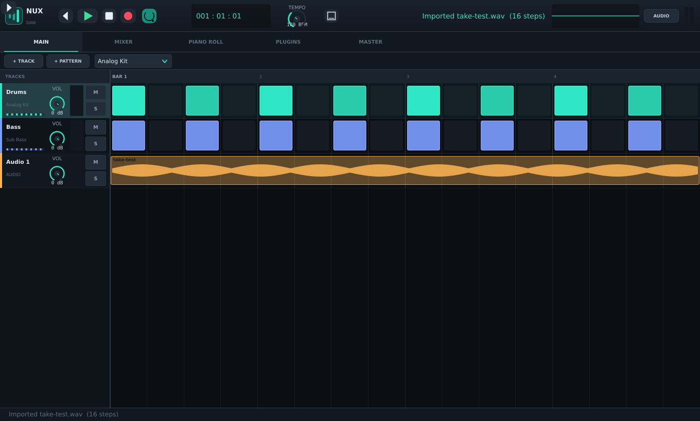

# NUX DAW

A digital audio workstation for Windows, written in C++20 with
[JUCE](https://juce.com) 9 and built with CMake.



> **Status: 0.4.0 in progress.** NUX plays, sequences, mixes, plays back audio
> clips, hosts VST3 effects *and* instruments in the audio path, saves projects
> (including plugin state) and exports WAV. It is **not** a finished DAW yet:
> there is no automation yet. Every edit is undoable, and effect parameters
> are editable from the mixer. `TODO-LIST.md` tracks the honest state of every
> feature.

---

## What works today

| Area | Status |
|---|---|
| Audio device setup (WASAPI, DirectSound, ASIO where installed) | ✅ |
| Stereo engine, 16 voices per track, MIDI input | ✅ |
| Built-in synth: Analog Kit, Sub Bass, Pluck, Warm Pad, Electric Keys | ✅ |
| Channel strip: EQ, compressor, delay, reverb, pan, fader, mute/solo, metering | ✅ |
| Mixer: 32 tracks, 8 buses with delay/reverb sends, master limiter | ✅ |
| Step sequencer + transport (tempo, loop, play / stop / record) | ✅ |
| Piano roll note editing | ✅ |
| VST3 hosting **in the signal chain** (effects and instruments) | ✅ |
| Plugin parameter state saved in the project | ✅ |
| Plugin editor windows, plugin chooser, per-slot bypass | ✅ |
| `.nux` project save / load, 24-bit WAV export | ✅ |
| **Audio clip playback, import and drag-and-drop** | ✅ |
| Undo / redo (`Ctrl+Z` / `Ctrl+Y`) | ✅ |
| Editable effect parameters (EQ, compressor, delay, reverb) | ✅ |
| Automation, MIDI learn | ❌ not yet |

Screenshots of every workspace live in [`docs/screenshots/`](docs/screenshots).

---

## Building on Windows (Visual Studio 2022)

**Requirements**

- Visual Studio 2022 with the *Desktop development with C++* workload
- CMake 3.22 or newer (bundled with VS 2022)
- Git

```bat
git clone --recurse-submodules https://github.com/hirushanethsara323-jpg/nux-daw.git
cd nux-daw

cmake -S . -B build -G "Visual Studio 17 2022" -A x64
cmake --build build --config Release --parallel
```

The executable lands in `build\NUX_artefacts\Release\NUX DAW.exe`.

If you cloned without `--recurse-submodules`, fetch JUCE (pinned to 9.0.5) with:

```bat
git submodule update --init --recursive
```

CMake will also fetch JUCE automatically if `external/JUCE` is missing.

**Run the tests**

```bat
ctest --test-dir build -C Release --output-on-failure
```

## Building on Linux (used for the reference build)

```bash
sudo apt install build-essential cmake ninja-build \
    libasound2-dev libx11-dev libxext-dev libxrandr-dev libxinerama-dev \
    libxcursor-dev libfreetype6-dev libfontconfig1-dev libcurl4-openssl-dev

cmake -S . -B build -G Ninja -DCMAKE_BUILD_TYPE=RelWithDebInfo
cmake --build build --parallel
ctest --test-dir build --output-on-failure
```

---

## Using NUX

| Action | Shortcut |
|---|---|
| Play / stop | `Space` or the transport button |
| Return to start | `Enter` |
| Toggle loop | `L` |
| New / open / save project | `Ctrl+N` / `Ctrl+O` / `Ctrl+S` |
| Save as | `Ctrl+Shift+S` |
| Export WAV | `Ctrl+E` |
| Audio settings | `Ctrl+,` |
| Switch workspace | `Alt+1` … `Alt+5` |

- **Main** – click a grid cell to toggle a step, drag to paint. Right-click a
  track header for its instrument, output bus, name and **Import audio file...**.
  You can also drag a WAV/AIFF/FLAC/Ogg/MP3 file straight onto a track lane.
- **Mixer** – faders, pan, mute/solo, insert slots and the two send effects per bus.
  Click an insert to choose an effect or a plugin; **double-click** it to open the
  parameter editor for that slot.
- **Piano Roll** – click to add a note, drag to move, right-click to delete,
  `Shift`-drag to change pitch.
- **Plugins** – scan the standard VST3 folders, then open a plugin editor.
- **Insert slots** – click an insert button on any mixer strip and choose
  *Plugin...* to load a VST3 into that channel, *Open plugin window* to show its
  editor, or a built-in effect. Hosted plugins process audio in place of the
  built-in slot, and an instrument plugin replaces the track's sampler.
- **Master** – master gain, limiter, export length and WAV export.

Projects are plain JSON with the `.nux` extension; the format is versioned and
NUX refuses to open files written by a newer schema rather than guessing.

---

## Architecture

```
src/
  nux_core/     Project model, .nux serializer, document state   (no audio deps)
  nux_engine/   Audio device, synth, channel strips, buses,
                transport, sequencer, VST3 manager, WAV export   (no GUI deps)
  nux_ui/       LookAndFeel, widgets, workspaces, main window
tests/          Unit tests + an end-to-end offline render test
```

The engine and the model are deliberately free of GUI dependencies so they can be
tested headlessly. `tests/` builds a console target that renders a project to a
WAV file and asserts the result is real audio.

Threading rules are documented at the top of `src/nux_engine/AudioEngine.h`:
the audio callback never allocates, and structural edits happen only while the
transport is stopped.

---

## Licence

Application code is MIT (see `LICENSE`). JUCE is used under its own licence:
you must either comply with the AGPLv3 or hold a commercial JUCE licence before
shipping NUX. The "NUX" name is also used by an existing audio equipment brand -
clear the trademark before any public commercial release.
